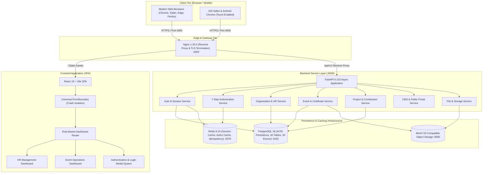
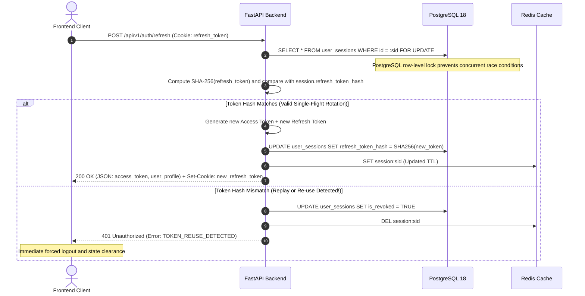
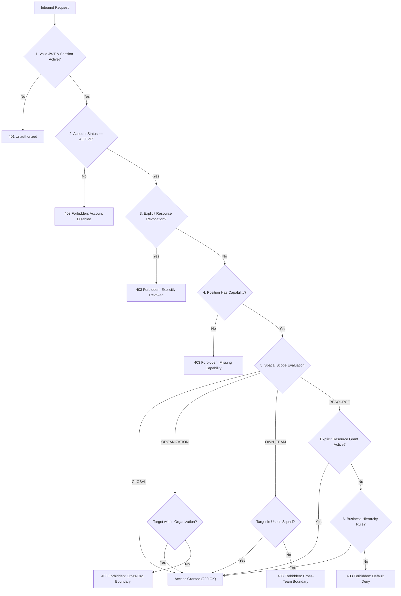
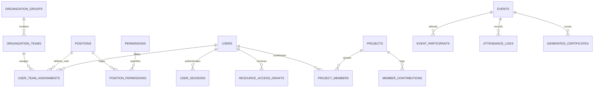
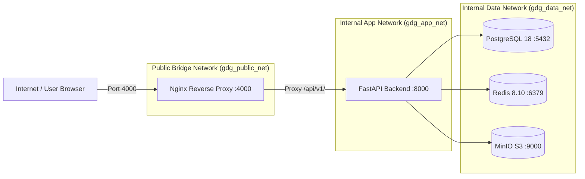

# GDG RMKEC Campus Platform: End-to-End Technical Documentation

**Authoritative Full-Stack Architecture, System Specification & Operational Manual**  
*Document Revision: 3.0 (Unified Frontend & Backend Hardening)*  
*Target Environment: Docker-First Containerized Cloud-Native Infrastructure & Modern Multi-Browser Web Client*

---

## 1. Executive Summary & Platform Identity

The **GDG RMKEC Campus Platform** is an enterprise-grade, cloud-native campus operations system designed for Google Developer Groups (GDG) at RMK Engineering College. The platform manages the full operational lifecycle of student developer chapters:
- **Hierarchical Human Resources:** Organization teams, positions, onboarding, promotions, and 360° member lifecycle tracking.
- **Projects & Contributions:** Collaborative initiative tracking with 4-dimensional authorship and active membership locks.
- **Event Operations & Logistics:** Lifecycle management, attendee imports, cryptographic append-only QR attendance, and automated certificate issuance.
- **Security & Authorization:** Multi-tenant 7-Step Role-Based Access Control (RBAC) with spatial scoping, token reuse detection, and global idempotency.
- **Responsive User Experience:** Modern React 18 frontend with theme switching, cross-browser normalization (Safari, Edge, Chrome, Firefox), robust error boundary crash containment, and mobile drawers.

### Unified Full-Stack Architecture Diagram



---

## 2. Technology Stack & Component Specifications

| Tier | Component | Technology / Library | Version | Purpose & Responsibilities |
| :--- | :--- | :--- | :--- | :--- |
| **Frontend** | Runtime / Framework | React | 18.3.1 | Component-driven reactive user interface |
| **Frontend** | Tooling & Bundler | Vite | 5.4.21 | Lightning-fast HMR and production tree-shaking |
| **Frontend** | Iconography | Lucide-React | 0.427.0 | Crisp, accessible SVG interface icons |
| **Frontend** | Styling System | Custom CSS Variables | Post-Phase 10 | Master design system, responsive grids, and Dark/Light mode tokens |
| **Frontend** | Crash Protection | Class ErrorBoundary | Custom | Catch rendering errors, display diagnostics, and allow seamless retry |
| **Backend** | Runtime Environment | Python | 3.12-slim-trixie | Async-first, high-throughput non-blocking runtime |
| **Backend** | Web Framework | FastAPI | $\ge$ 0.115.0 | High-performance asynchronous REST API with auto OpenAPI 3.1 specs |
| **Backend** | Database Engine | PostgreSQL | 18 | ACID relational database with custom enums, partial indexes & advisory locks |
| **Backend** | Async DB Driver | asyncpg | $\ge$ 0.30.0 | High-performance binary protocol driver |
| **Backend** | ORM & Migrations | SQLAlchemy + Alembic | 2.0.36 / 1.14.0 | Declarative mappings, async sessions, and reversible migration ledger |
| **Backend** | In-Memory Cache | Redis | 7.4 / 8.10.0 | Session tokens, authorization cache (`authz:*`), and idempotency store |
| **Backend** | Object Storage | MinIO / AWS S3 | S3 Compatible | Multi-tenant storage for certificates, event media, and assets |
| **Backend** | ASGI Server | Uvicorn | $\ge$ 0.34.0 | ASGI web server with worker clustering |
| **Backend** | Structured Logging | structlog | $\ge$ 24.4.0 | Contextual JSON logs with distributed tracing metadata |
| **Gateway** | Web Server / Proxy | Nginx | 1.30.4 | Reverse proxy, static asset delivery, rate limiting, and gzip compression |

---

## 3. End-to-End Architectural Principles & Invariants

### 3.1 Layer Dependency Hierarchy (SOLID Dependency Inversion)

The entire platform conforms strictly to clean layered architecture:

```
[ Frontend View / UI Components ]
               │
               ▼
   [ Frontend Service Layer ]
  (authService, dbService, eventsDbService)
               │  HTTP REST /api/v1/
               ▼
      [ FastAPI Route Layer ]
      (Thin Controllers, Parameter Extraction, Depends())
               │
               ▼
    [ Application Domain Services ]
    (Business Rules, Invariants, Transactions, Auditing)
         │                   │                   │
         ▼                   ▼                   ▼
[ Repositories ]      [ Redis Core ]     [ MinIO S3 Storage ]
(BaseRepository)    (Authz/Session/Lock)   (Presigned Media)
         │
         ▼
[ PostgreSQL 18 ]
```

### 3.2 Non-Negotiable Invariants

1. **Thin Controller Rule:** API route handlers never contain raw business logic or direct database queries. Their sole responsibility is parameter validation, dependency injection via `Depends()`, invoking domain services, and returning Pydantic schemas.
2. **Repository Isolation:** Domain services never execute raw SQL or handle raw `AsyncSession` directly. All persistence is encapsulated behind repositories subclassing `BaseRepository`.
3. **Transaction Ownership:** Domain services define transactional boundaries (`await db.commit()` / `await db.rollback()`). Mutations write audit log records atomically before committing.
4. **Zero Token Leakage:** Refresh tokens are never returned in JSON response bodies. They are stored and rotated exclusively via `HttpOnly; Secure; SameSite=Strict` cookies.
5. **No Physical Deletions:** Business records are never subjected to physical `DELETE` queries. Soft-deletion sets `deleted_at = now()` and `deleted_by = actor_id`. Repositories automatically enforce `WHERE deleted_at IS NULL`.
6. **Graceful UI Containment:** Runtime JavaScript errors must never cause a blank white screen. The `ErrorBoundary` isolates crashes to specific components or provides a branded retry fallback.

---

## 4. Authentication, Session Lifecycle & Transport Security

### 4.1 Dual-Token Architecture

The platform separates access delegation from session persistence using dual cryptographic JWTs:
- **Access Token:** Short-lived (15 minutes). Carries `sub` (user_id), `session_id`, `email`, `jti`, and `type: "access"`. Managed strictly in-memory by the frontend client; never persisted in `localStorage` or `sessionStorage` to eliminate XSS token theft.
- **Refresh Token:** Long-lived (7 days normal, 30 days remember-me). Carries `type: "refresh"`. Dispatched exclusively via browser cookies:
  ```http
  Set-Cookie: refresh_token=<JWT>; HttpOnly; Secure; SameSite=Strict; Path=/; Max-Age=604800
  ```

### 4.2 Strict Single-Flight Token Rotation & Reuse Detection

To prevent replay and token theft attacks, every refresh request rotates the token under a row-level database lock:



### 4.3 Account Lifecycle Synchronization

Account status changes instantly propagate across active sessions:
- **Password Reset:** Generates a cryptographically secure OTP, verifies entropy, updates the password hash, and terminates all active sessions in PostgreSQL and Redis.
- **Account Disablement:** Transitioning a member to `SUSPENDED` or `TERMINATED` immediately invalidates their Redis session keys and revokes active sessions in PostgreSQL.

---

## 5. Canonical Authorization & 7-Step RBAC Engine

Every API request mutating a resource or reading privileged data passes through `AuthorizationService.evaluate_authorization()`:



### 5.1 Canonical Position & Scope Matrix

| Canonical Position | Default Spatial Scope | Domain Authorities |
| :--- | :--- | :--- |
| `GDG_LEAD` | `GLOBAL` | Unrestricted authority across all campus domains, configuration, projects, and finance. |
| `HR_LEAD` | `ORGANIZATION` | Full organization-wide member management, invitations, onboarding, promotions, and 360° views. |
| `TEAM_LEAD` | `OWN_TEAM` | Team-scoped member management, project coordination, task assignments, and event attendance ops. |
| `TEAM_MEMBER` | `OWN_TEAM` / `LIMITED` | Personal profile management, contribution logging, task execution, and event RSVPs. |

### 5.2 Anti-Escalation & Resource Grants

Resource access grants (`resource_access_grants`) permit temporary delegation (e.g., delegating event coordination to an active member) with strict anti-escalation rules:
- **No Self-Escalation:** Users cannot grant permissions to their own account.
- **Capability Bounding:** Granters cannot delegate capabilities they do not personally hold.
- **Scope Restriction:** Granters with `OWN_TEAM` scope cannot grant `ORGANIZATION` or `GLOBAL` scope.
- **Revocation Overrides:** An explicit grant marked `REVOKED` overrides position-level permissions.

---

## 6. Database Architecture & Canonical Schema Ledger

The database layer consists of **40 canonical tables** and **26 custom PostgreSQL enum types** managed by Alembic:



### 6.1 Complete Alembic Migration Ledger

| Version | Migration Identifier | Core Changes & Invariants Enforced |
| :---: | :--- | :--- |
| **001** | `001_create_users_sessions_activity_logs` | Created core `users`, `user_sessions`, and append-only `activity_logs`. |
| **002** | `002_hierarchical_rbac` | Initial schema for permissions and role definitions. |
| **003** | `003_user_sessions_remember_me` | Added `remember_me` boolean to `user_sessions` for extended 30-day TTLs. |
| **004** | `004_hr_org_tables` | Established canonical organization groups, teams, positions, and assignment history. |
| **005** | `005_session_refresh_token_tracking` | Introduced `refresh_token_hash` in `user_sessions` for single-flight token rotation. |
| **006** | `006_consolidate_unified_v2_schema` | Comprehensive consolidation across all campus operational domains. |
| **007** | `007_relax_transfer_history_team_id` | Nullable foreign key on team transfer history to support initial user onboarding. |
| **008** | `008_position_permissions_scope` | Mapped canonical positions (`GDG_LEAD`, `HR_LEAD`, `TEAM_LEAD`, `TEAM_MEMBER`) to spatial scopes. |
| **009** | `009_member_lifecycle_states` | Established 5 account lifecycle states (`INVITED`, `ACTIVE`, `SUSPENDED`, `TERMINATED`, `ALUMNI`). |
| **010** | `010_project_membership_and_team` | Created `projects` and `project_members` with partial unique index `uq_project_member_active`. |
| **011** | `011_communications_tasks_notifications` | Created `communications`, `tasks`, and polymorphic `notifications`. |
| **012** | `012_events_attendance_certificates` | Created event management, CSPRNG QR scan logs, and certificate issuance tables. |
| **013** | `013_cms_files_cleanup` | Created newsletters, announcements, `website_settings`, and uploaded file tracking. |
| **014** | `014_canonical_data_migration` | Executed preflight audit (`rows_checked = 9356`, `rows_failed = 0`), advisory lock triggers. |
| **015** | `015_decommission_legacy_tables` | Dropped legacy `teams`, `roles`, and `role_permissions` after verifying 0 unmapped users. |

---

## 7. Frontend Application Architecture

The frontend is an optimized Single Page Application (SPA) structured for clarity, responsiveness, and resilience.

### 7.1 Source Code Directory Topology

```
src/
├── App.jsx                     # Top-level state, dashboard router, toast notifications
├── main.jsx                    # Application root, ErrorBoundary, global error listeners
├── index.css                   # Master design system, responsive breakpoints, CSS tokens
├── components/
│   ├── ErrorBoundary.jsx       # Universal error boundary with diagnostic drawer & recovery
│   ├── LoginForm.jsx           # Branded login card with Google SSO and College Email ID
│   ├── HrDashboard.jsx         # HR Management Dashboard (Stats, Teams, Donut Chart, Projects)
│   ├── EventDashboard.jsx      # Event Management Dashboard (Action Cards, Attendance, Certs)
│   ├── Sidebar.jsx             # Off-canvas mobile drawer & desktop branding sidebar
│   ├── TopHeader.jsx           # Global header with search, theme toggle, and profile badge
│   ├── TeamGroupedList.jsx     # Member columns grouped by HR, Tech, and Event Management
│   ├── TeamDonutChart.jsx      # SVG dynamic ratio donut chart for team member distribution
│   ├── CertificatesTable.jsx   # Recently issued certificates with modal view links
│   ├── UpcomingEventsList.jsx  # Event calendar cards with date badges and attendee counts
│   ├── RecentAttendanceList.jsx# Attendance percentage rings with live scan summaries
│   ├── AddPeopleModal.jsx      # Multi-field member registration modal with auto-scrolling
│   ├── MemberProfileModal.jsx  # Member 360 profile drawer with promotion & transfer controls
│   ├── SwitchTeamModal.jsx     # Inter-squad transfer modal with transactional history
│   ├── CreateEventModal.jsx    # Event scheduler modal with date and venue pickers
│   ├── MarkAttendanceModal.jsx # Live attendee check-in and QR verification modal
│   └── ViewCertificateModal.jsx# Digital certificate preview modal
└── services/
    ├── authService.js          # Authentication service (JWT exchange, session caching)
    ├── dbService.js            # Persistent member repository with localStorage offline cache
    └── eventsDbService.js      # Persistent event, attendee, and certificate repository
```

### 7.2 Universal Error Boundary (`ErrorBoundary.jsx`)

The frontend implements a production-grade React class Error Boundary that catches runtime rendering exceptions:
- **Global Error Listeners (`main.jsx`):** Registers `window.addEventListener('unhandledrejection')` and `window.addEventListener('error')` to capture asynchronous exceptions.
- **Crash Containment (`App.jsx`):** Wraps both the root application and individual dashboard routers. A bug in an event chart never crashes the navigation shell or toasts.
- **Interactive Recovery:** Users can trigger **"Try Again"** (resets error state), **"Reload Page"**, or **"Clear Cache & Reset"** (clears `localStorage`/`sessionStorage` and restarts).
- **Diagnostics Drawer:** Collapsible technical drawer displaying the exact error message and component stack with a one-click **"Copy stack"** button.

### 7.3 Multi-Browser Normalization & Compatibility Matrix

| Browser Family | Target Version | Engine | Normalizations Applied |
| :--- | :--- | :--- | :--- |
| **Apple Safari (macOS & iOS)** | Safari 14+ / iOS 14+ | WebKit | `-webkit-backdrop-filter: blur(8px)`, `-webkit-appearance: none`, `100dvh` viewport height fallback, `-webkit-overflow-scrolling: touch`, `format-detection="telephone=no"`. |
| **Google Chrome** | Chrome 87+ | Blink / V8 | Optimized `-webkit-autofill` background reset, `::-webkit-scrollbar` styling, standard ES2020 transpilation. |
| **Microsoft Edge** | Edge 88+ | Chromium | `<meta http-equiv="X-UA-Compatible" content="IE=edge" />`, standard Chromium flexbox/grid layout. |
| **Mozilla Firefox** | Firefox 78+ | Gecko / SpiderMonkey | `scrollbar-width: thin`, `scrollbar-color`, `-moz-osx-font-smoothing: grayscale`. |

### 7.4 Multi-Breakpoint Responsive Design System

The application layout adapts fluidly across device form factors:
- **Desktop Screens ($> 1200\text{px}$):** 4-column summary metric cards, 3-column team distribution grid, side-by-side bottom analytical widgets.
- **Laptops & Tablets Landscape ($900\text{px} - 1200\text{px}$):** 2-column metric cards, single-column stacked team sections.
- **Tablets Portrait ($\le 900\text{px}$):** Desktop sidebar transitions into a slide-out off-canvas drawer (`.dark-sidebar.mobile-open`) with a darkened tap-to-close backdrop (`.sidebar-mobile-backdrop`).
- **Mobile Phones ($\le 768\text{px}$):** Single-column stat cards, compact header with auto-shrinking search bar ($150\text{px}$), hidden background decorative badges, fluid full-width modal forms with `max-height: 90dvh` auto-scrolling.
- **Compact Handsets ($\le 480\text{px}$):** User profile header converts to avatar-only icon, modal padding adjusts to bottom-sheet style, preventing form input clipping.

---

## 8. Core Domain Subsystems & Business Rules

### 8.1 HR Lifecycle & Member 360° Projection

- **State Machine:**
  $$\text{INVITED} \longrightarrow \text{ACTIVE} \longleftrightarrow \text{SUSPENDED} \longrightarrow \text{TERMINATED} \longrightarrow \text{ALUMNI}$$
  - Direct transitions $\text{TERMINATED} \to \text{ACTIVE}$ and $\text{ALUMNI} \to \text{ACTIVE}$ are strictly rejected with `HTTP 409 Conflict`.
- **Concurrency Invariant:** Core team lead assignments utilize PostgreSQL transaction advisory locks (`pg_advisory_xact_lock`), guaranteeing that race conditions during simultaneous promotions cannot produce duplicate active leads for a squad.
- **Privacy Tiers:**
  - *Tier A (Self):* Full profile, personal contributions, active tasks.
  - *Tier B (Team Lead):* Restricted exclusively to members of the lead's squad.
  - *Tier C (HR Lead):* Organization-wide visibility into lifecycle transitions and transfer histories.
  - *Tier D (GDG Lead):* Global unrestricted view.
  - *Universal Redaction:* Password hashes, refresh token digests, and session identifiers are permanently omitted from all API responses.

### 8.2 Projects, Collaborations & Contribution Tracking

- **Project Lifecycle:**
  $$\text{PROPOSED} \longrightarrow \text{IN\_PROGRESS} \longrightarrow \text{COMPLETED} \longrightarrow \text{ARCHIVED}$$
  - $\text{ARCHIVED}$ is a terminal state; modifications return `HTTP 400 Bad Request`.
- **Collaborator Integrity:** Enforced via partial unique index:
  ```sql
  CREATE UNIQUE INDEX uq_project_member_active ON project_members(project_id, user_id) WHERE (is_active = true);
  ```
- **4-Dimensional Authorship:** Every contribution logs `user_id` (contributor), `created_by` (immutable author), `updated_by` (modifier), and `deleted_by` (soft-delete actor).
- **Zero-$N+1$ Aggregations:** Project 360° views use single-query SQL aggregation for total contributions, hours logged, and category distributions.

### 8.3 Events, Append-Only Attendance & Certificates

- **Lifecycle:** $\text{DRAFT} \to \text{PUBLISHED} \to \text{UPCOMING} \to \text{ONGOING} \to \text{COMPLETED} \to \text{CANCELLED}$.
- **Cryptographic Attendance:**
  - QR bearer tokens are generated with 256 bits of CSPRNG entropy (`secrets.token_urlsafe(32)`).
  - Only cryptographic SHA-256 hashes (`qr_code_hash`) are stored in PostgreSQL; raw bearer tokens are never persisted in plain text.
- **Certificate Reissuance (Option B):**
  - Enforces active unique certificate index:
    ```sql
    CREATE UNIQUE INDEX uq_event_participant_active_cert ON generated_certificates(event_id, participant_id) WHERE (status = 'ISSUED');
    ```
  - Reissuing a certificate revokes the existing certificate atomically within the same database transaction.
  - Public verification route (`/api/v1/certificates/verify/{certificate_number}`) exposes validation metadata with zero Personally Identifiable Information (PII).

### 8.4 File Management & MinIO Object Storage

- **Upload Defense In-Depth:**
  - Strict extension allowlist and MIME validation.
  - Magic-byte inspection ensuring declared file headers match binary payloads.
  - Path traversal and double-extension sanitization.
  - **Unconditional SVG Rejection:** `.svg` and `image/svg+xml` uploads are rejected to prevent stored Cross-Site Scripting (XSS).
- **Presigned URLs:** Generated on-demand with strict expiration windows (15 minutes for private records, 60 minutes for public assets). Presigned URLs are never cached in Redis.

---

## 9. API Route Catalog & Frontend Mapping

| Route Prefix | Domain | Method | Primary Endpoint | Description & Auth Scope | Frontend Trigger |
| :--- | :--- | :---: | :--- | :--- | :--- |
| `/api/v1/auth` | Auth | `POST` | `/login` | Authenticate with credentials; issue dual tokens | `LoginForm` submit |
| `/api/v1/auth` | Auth | `POST` | `/refresh` | Single-flight refresh token rotation via cookie | App initialization / 15m timer |
| `/api/v1/auth` | Auth | `GET` | `/me` | Retrieve profile and assigned capabilities | State hydration |
| `/api/v1/auth` | Auth | `POST` | `/logout` | Invalidate session in Redis & PostgreSQL | `TopHeader` user pill |
| `/api/v1/auth` | Auth | `POST` | `/forgot-password` | Request password reset OTP | `ForgotPasswordModal` |
| `/api/v1/organization` | Org | `GET` | `/hierarchy` | Fetch organizational groups and squads | Dashboard sidebar & stats |
| `/api/v1/organization` | Org | `GET` | `/teams/{id}/members` | Fetch members assigned to specific squad | `TeamGroupedList` |
| `/api/v1/organization` | Org | `POST` | `/assignments` | Assign member to squad with advisory lock | `SwitchTeamModal` |
| `/api/v1/hr` | HR | `POST` | `/invitations` | Dispatch single-use onboarding invite token | `AddPeopleModal` |
| `/api/v1/hr` | HR | `POST` | `/members/{id}/suspend` | Suspend user and revoke Redis sessions | `RemoveMemberModal` |
| `/api/v1/hr` | HR | `GET` | `/members/{id}/360` | Assemble tiered 360° member projection | `MemberProfileModal` |
| `/api/v1/projects` | Projects | `GET` | `/` | List active projects with metrics | `ProjectsOverview` |
| `/api/v1/projects` | Projects | `POST` | `/{id}/contributions` | Record contribution with 4D authorship | Contribution drawer |
| `/api/v1/events` | Events | `GET` | `/` | List upcoming and past chapter events | `UpcomingEventsList` |
| `/api/v1/events` | Events | `POST` | `/` | Schedule new event with dates and venue | `CreateEventModal` |
| `/api/v1/events` | Events | `POST` | `/{id}/attendance/scan` | Check in attendee via hashed QR token | `MarkAttendanceModal` |
| `/api/v1/events` | Events | `POST` | `/{id}/certificates` | Batch issue certificates with unique constraint | `GenerateCertificateModal` |
| `/api/v1/certificates` | Public | `GET` | `/verify/{number}` | Public cryptographic certificate verification | `ViewCertificateModal` |
| `/api/v1/files` | Storage | `POST` | `/upload` | Magic-byte verified file upload to MinIO | Profile photo uploader |
| `/api/v1/portal` | CMS | `GET` | `/home` | Cached public landing page aggregator | Public Chapter Portal |

---

## 10. Cross-Cutting Patterns, Resilience & Security Controls

### 10.1 Global Redis Idempotency Engine

Mutating API endpoints (`POST`, `PUT`, `PATCH`) support the client-supplied `Idempotency-Key` header:
- Evaluates the key against Redis key `idempotency:{scope}:{key}` with a 24-hour TTL.
- Replaying an identical request returns the cached response with `X-Cache-Replay: true`.
- Submitting an identical key with a conflicting payload aborts immediately with `HTTP 409 IDEMPOTENCY_CONFLICT`.

### 10.2 Transactional Audit Logging Protocol

Every database mutation follows a strict sequence:
1. Verify pre-conditions and authorization boundaries.
2. Execute relational mutation (`INSERT` / `UPDATE`).
3. Insert `ActivityLog` entry (`actor_id`, `action`, `resource`, `diff_payload`).
4. Commit database transaction.
5. Evict scoped Redis authorization and session keys (`authz:{user_id}`).

> [!IMPORTANT]
> If a database error occurs at steps 2 or 3, the entire transaction rolls back cleanly, ensuring zero orphaned audit logs and preventing premature cache invalidations.

---

## 11. Infrastructure, Container Topology & Operational Runbook

### 11.1 Container Orchestration Topology (`docker-compose.yml`)

The platform deploys across three isolated Docker networks:



### 11.2 Essential Operational Commands

```bash
# 1. Start complete full-stack container stack
docker compose up -d --build

# 2. Run database migrations to latest schema
docker compose run --rm backend alembic upgrade head

# 3. Execute backend test suite with coverage
docker compose run --rm backend pytest tests/ -v --cov=app

# 4. Code quality and formatting audit
docker compose run --rm backend ruff check .
docker compose run --rm backend ruff format --check .

# 5. Dependency security audit
docker compose run --rm backend pip-audit

# 6. Verify migration reversibility
docker compose run --rm backend alembic downgrade -1
docker compose run --rm backend alembic upgrade head

# 7. Frontend development server
npm run dev

# 8. Frontend production build
npm run build
```

### 11.3 Cryptographic Backup Standard (RFC 9580)

Database backups adhere to the **RFC 9580** specification using Sequoia PGP:
- **Format:** PostgreSQL custom dump $\longrightarrow$ OpenPGP v6 message $\longrightarrow$ X25519 recipient encryption $\longrightarrow$ Version 2 SEIPD (Packet Type 18) with AES-256-OCB AEAD authenticated encryption $\longrightarrow$ Ed25519 digital signature.
- **Key Safety:** Private decryption keys reside in an isolated offline vault and are never mounted into running containers.

---

## 12. Verification, Test Suites & Empirical Metrics

### 12.1 Backend Test Coverage (292 Tests, 100% Passing)

```
tests/
├── auth/ (4 files, 25 tests)            --> 100% Passed (Tokens, sessions, reset, cookies)
├── authorization/ (4 files, 62 tests)   --> 100% Passed (Precedence, scopes, bounded grants)
├── cms/ (6 files, 18 tests)             --> 100% Passed (Invalidations, portal, contact form)
├── communications/ (1 file, 5 tests)    --> 100% Passed (Dispatch, scheduling, target filtering)
├── events/ (11 files, 35 tests)         --> 100% Passed (Lifecycle, QR scan, certificates)
├── files/ (2 files, 11 tests)           --> 100% Passed (Upload defenses, SVG rejection, MinIO)
├── hr/ (10 files, 42 tests)             --> 100% Passed (State transitions, invites, 360 tiers)
├── notifications/ (1 file, 3 tests)     --> 100% Passed (Dispatch, read status)
├── organization/ (3 files, 29 tests)    --> 100% Passed (Hierarchy, advisory locks, transfers)
├── projects/ (6 files, 29 tests)        --> 100% Passed (Lifecycle, active uniqueness, 360 metrics)
├── tasks/ (1 file, 5 tests)             --> 100% Passed (Status updates, team assignment)
├── test_invariants.py (7 tests)         --> 100% Passed (Database triggers, constraints)
├── test_phase1_schema_foundation.py     --> 100% Passed (40 canonical tables, enum audits)
└── test_smoke.py (1 test)               --> 100% Passed (FastAPI app factory startup)
```

### 12.2 Empirical Summary Metrics

- **Backend Pytest Pass Rate:** **292 / 292 Passed (100%)** across 61 test files.
- **Backend Line Coverage:** **~82%** total line coverage across `backend/app/`.
- **Frontend Build Status:** **Production Build Clean (0 errors, 0 warnings)** via Vite 5.
- **Live Contract Scenarios:** **16 / 16** reverse proxy contract scenarios passed against live Docker containers on port 4000.
